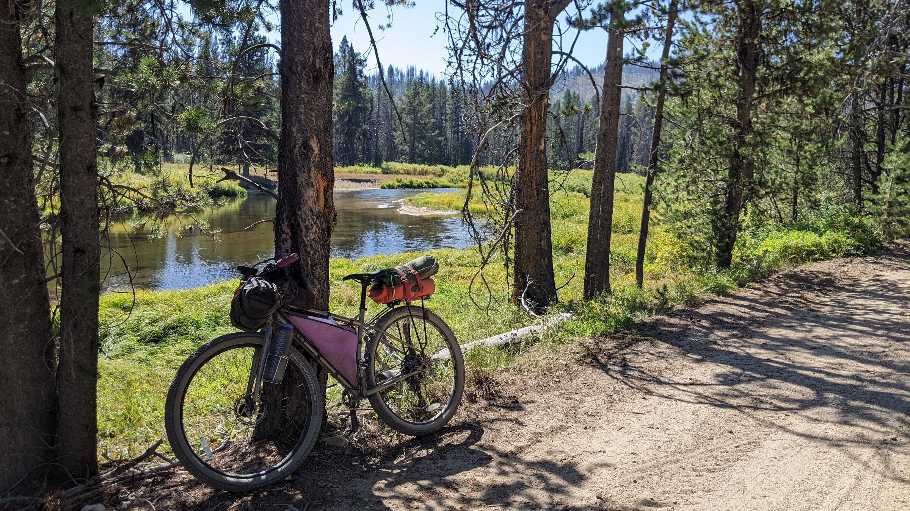
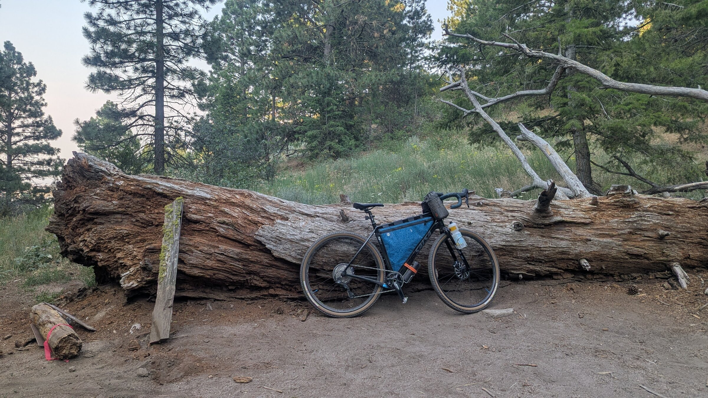
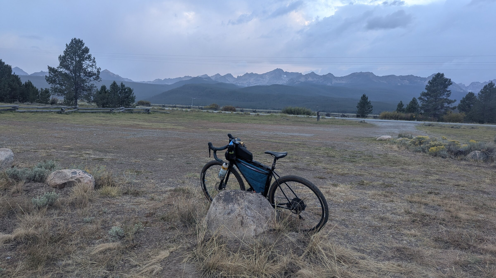
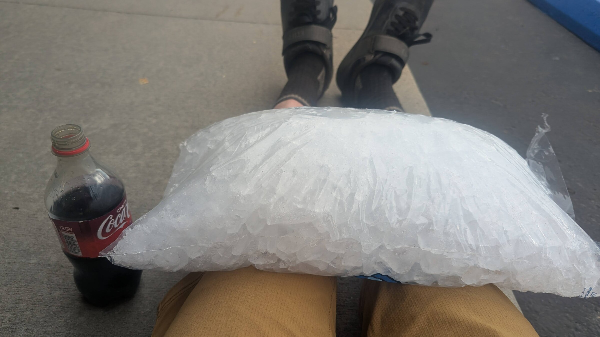
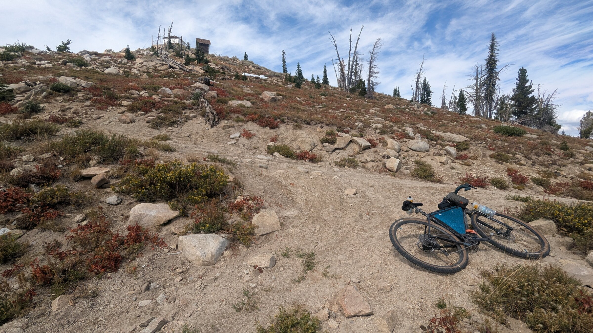
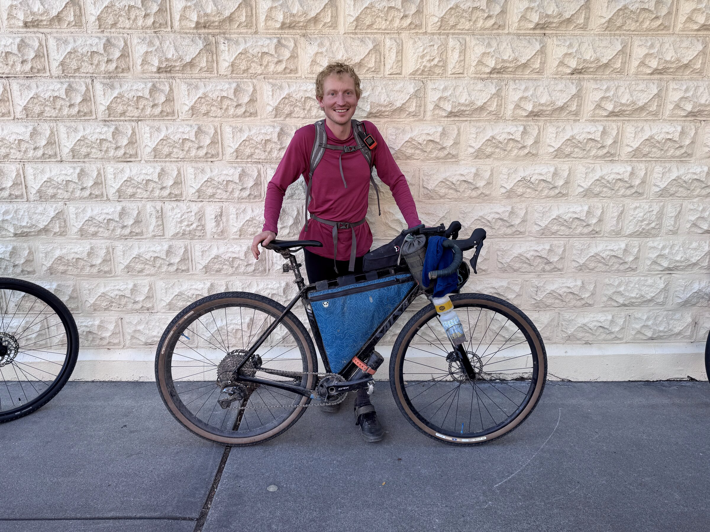

+++
date = '2026-10-11T11:12:37-06:00'
title = 'Smoke and Fire 2026'
tags = ['cycling', 'outdoors']
+++

*Update - The first place finisher from 2026 Smoke and Fire posted a [cool video](https://youtu.be/pOpNrrZhNNE?si=ZzkzV4j_oYT-PGg4) which I think captures the character of the event very well!*

# Background

The [Smoke and Fire](https://idahosmokeandfire.org/) is a 400ish mile self supported bikepacking race in Idaho, starting and ending a couple miles from my home in Boise. The route has around 40 thousand feet of elevation gain, and is a mix of gravel roads, dirt roads, and single track trails. The ethos of the race, similar to other self supported bikepacking outings, is that you complete the route under your own power only using resources available to all riders. There are no official aid stations, and you are responsible for your own safety. There is an official 'Grand Depart' time around Labor Day each year, but you can also ride the route as an ITT (Independent Time Trial).

I attempted to ride the "Fire and Smoke" (the route in reverse) back in the fall of 2022, after only having done a couple other overnight bike rides. In 2022, I was unable to make the Grand Depart time due to a wedding, so I started my ride a few days earlier and intended to pass through the Smoke and Fire pack. I ended up diverting from the route and scratching in Stanley (about half way), because of poor sleep, saddle sores, and just generally feeling out of energy. There also was a wildfire which ended up blocking the route, which was all the more reason for me to throw in the towel.

# Preparation

After my failed attempt in 2022, I always had in the back of my mind that I wanted to actually complete this route. Ashley and I toured the Hot Springs route, which covers much of the same ground, in the summer of 2024. So I felt like I generally knew the route and what to expect, which was very helpful.

On my 2022 attempt, I was riding a Surly Ogre, and packed a lot I really didn't need. My goal this year was light and fast - I rode my Salsa Warbird and heavily scrutinized everything in my kit. My full packing list is here (attaach packing list). I brought a lightweight tent in 2022, but was too amped up after riding all day and basically didn't sleep at all on the race. This year I trimmed down the sleep kit to just a 20 degree sleeping bag, sleeping pad, and small tarp. I saw the weather forecast leading in to the race was calling for rain - so I included a dry bag to keep my sleeping bag dry, and opted for a heavier duty rain jacket. But, I really didn't have a way to stay dry when sleeping (I could've faffed with building a shelter with the tarp in an extreme situation, but didn't want to plan on this). I figured I would just ride until I found some kind of shelter (pit toilets are popular in these events).

As far as training for the ride, my plan was mostly to just ride, *a lot*. I had a few cycling events planned for my summer (Boise Sunset Century, Seattle to Portland ride), and got a good volume of mountain and gravel biking in otherwise. All in I got around 2600 miles and 163 thousand feet of vert in before the event, which is more than I've ridden any other year. I rode a fair amount of single track on my Warbird and my bike handling on the drop bar gravel bike was feeling dialed. Outside of biking I did a copious amount (~3 hours / week) of physical therapy to remedy a hip impingement.

# Day 1: Boise - (almost) Ketchum

The Grand Depart time this year was 6am on Thursday, September 3rd. As expected, I slept like crap the night before - the nerves and excitement were real. My friend Henry, who was also racing, stayed at our place, so Ashley, him and I all biked to the start together. There were probably around 40 riders at the start, and a good amount of other community there to send everyone off.

I started off feeling strong, blasting through the first 70 miles chatting with acquaintances, an old coworker, and other racers. Most of this time I ended up riding with Andy, who owned a bike shop near Ketchum. Funny enough I found out that it was his shop which ended up servicing my buddy Henry's bike days before race (he has some catastrophic brake issues on his final training ride). Small world. I started to feel a hint of knee pain as were rolling into the little town of Pine, the first major resupply stop. I thought it might be a cramp or some muscle thing, and mostly just rode through it.

As the day went on my knee kept bothering me, so I significantly slowed my pace which helped a lot. My original goal was to make Ketchum just after nightfall, but that was out of the picture now. I started the ~3000 foot climb over Dollarhide summit as the sun was setting, and reached the top around 10pm. Andy's wife and bike shop staff were posted up with their van at the top of Dollarhide, handing out hot dogs, drinks, and snacks, which were much appreciated.

I hung out at the top for a while, and then bundled up and started the descent. I was very tired at this point, so I was looking for the first decent spot to bed down for the night. I found a large tree which looked like it would mostly keep me dry. I was able to sleep pretty well, save for getting startled awake by some kind of animal checking out my bike. I thought it was either a moose or a bear, or maybe I was just seeing things.

# Day 2: (almost) Ketchum - Stanley

The next day I rolled down the rest of the descent in to Ketchum. I had booked a hotel room in Stanley for the second night ahead of time, so I really wanted to make it there. After a brief break and reset at the Rotary Park shelter and a resupply at the gas station I started on to the single track sections out of town. I had ridden some of these trails before so it helped to know what to expect. Shortly after I started up Adam's Gulch the rain started really coming down, and the trails got quite muddy. I kept plodding on, at times really enjoying some of the descents through the trees. Before too long I made it to the smooth and chill Harriman Trail section, where I ran into another rider Rob who was having some navigation issues.

The Harriman Trail dumps you right in to Galena Lodge where I was excited to get some proper food and take a break before the infamous Titus Lake hike a bike. Rob also rolled in to the lodge and joined me while I was scarfing down a burger and fries. This was his first time on the Smoke and Fire, but he was a [Tour Divide](https://tourdivide.org/) veteran, so it was cool to chat with him. It was about 2pm when we left Galena Lodge, and we both figured that we'd be able to make it to the Redfish Lake Lodge before they closed at 9pm.

Rob and I mostly stuck together through the Titus Lake hike a bike and descent (which really weren't that bad, especially knowing we were in for some walking), after which I took a break and Rob continued on. There was a nice gentleman camping out just at the start of Valley Rd handing out snacks to riders. This is known within the bikepack racing community as 'trail magic'. I cruised through the valley and made it to the start of the Fischer Williams loop. After a Twinkie at the top of the climb I descended Fischer Williams and contemplated my options. At this point I think it was around 7pm, so I know it would be a crunch to make it to Redfish Lodge before closing. Instead of pushing it, I enjoyed a beautiful Sawtooth sunset and ate some chips and candy bars, figuring I'd make it to the lodge a bit after 9.

By the time I hit the Redfish Lake single track section, it was fully dark. This section was much more technical than I expected, and my knees were really starting to feel the pain. After lots of on and off the bike I checked my GPS and saw that I had a long ways to get to the lodge. Between the dark and my knees it was real slow going, and of course it started raining again to add to the fun.

Around 10:30pm I hit the pavement at Redfish lake, and I was beat. It was pouring rain, and my knees were in a bad way. The route circled past the lodge, and then followed another section of single track which I had done before and knew was quite rocky. I figured if I stayed on route, I would get to Stanley past midnight, and my knees would not like it. It was also feeling quite cold and wet at this point - the warmth of the Mountain Village Inn was calling. I ended up deviating from the route to hit the highway and reached my hotel around 11:30pm. 

At this point, I felt that I was most likely going to have to scratch because of my knee issues. I was unable to straighten my left leg fully. I took a shower, hung up my entirely soaked kit, and went to bed without setting an alarm. I knew if I was going to keep going, that I would need to find a way to recoup and recharge, so getting a lot of sleep seemed like the move.

# Day 3: Stanley - Bear Valley

The next morning I hobbled down to the Mountain Village restaurant for breakfast. My buddies Erik and Bryan, who both completed SnF a couple years ago, gave me calls and texts of encouragement (*super helpful!*). Aside from my knees, I felt pretty dang good, so I decided I wasn't ready to scratch quite yet. I planned to ride the highway back to where I deviated from the route, and the circle back to Stanley on the route, at which point I could decide if my body was up to keep going.

The riding felt OK. My bike started to have some shifting issues which were really becoming a problem for tackling steep hills with my sore knees. On the descent back into Stanley I found a nice pine tree bike stand and got my derailleur indexed such that the easier gears shifted well at least.

Rolling back into Stanley I was still unsure if I should keep going. Thinking of what my options were, I had the idea that maybe icing my knees could help. I loaded up on snacks at the grocery store, and took a nice break out front, chugging a Fanta with a full bag of ice on my knees. Another rider rolled up who had started a day after the Grand Depart and rode through the night to get to Stanley. It was great to chat with someone else who was also feeling rough around the edges. The ice really did seem to help my knees, so I plodded on out of Stanley. The gravel sections were actually feeling pretty bearable if I took it easy, and I knew that most of the rest of the route was on roads, so I started to feel some optimism that I may be able to pull out of the rut I was in and finish the race.

The riding went smoothly until I reached the top of the Elk Meadows section, where there was more rocky single track on the descent. I think with my hard tail and fresh legs this would've been a super fun trail, but in my current state I was dreading every single rock and steep climb. Just when my spirits were at about bottom, another rider, Devin, caught up to me. We chatted a bit and rode the (finally) smooth single track section back down to the highway.

At this point, I was still not sure if I should continue on. I was constantly going through the scenarios in my head. I settled on a plan to find some shelter before, or at the top of, the climb over Cape Horn Summit. This would mean that I could see how my body felt in the morning, and if the knees were getting worse I could roll all downhill to a logical spot for Ashley to scoop me up. I kept riding, keeping an eye out for anything which would give me cover from the rain that I knew would be coming later in the night. After passing some rednecks who tried to convince me to take a vodka shot, I rolled up on some more trail magic. Connie (a Smoke and Fire finisher from a year or two ago) and her husband had their camper set up, and gave me hot broth and warm pizza. Truly magical. They were great to chat with, and also had an ice pack for my knees. Connie suggested I push on to go over Cape Horn Summit, and then ride all downhill to the Bruce Meadows rest stop, where there were pit toilets to serve as shelter. Also, she said that another friend of theirs was camped out there offering more trail magic. The warm food, iced knees, and great camaraderie with a past SnF racer convinced me to deviate from my earlier plan and commit to going up and over Cape Horn for the night.

The climb up Cape Horn felt really good, and though I was getting tired the descent went by quickly. Before I knew it I was at the Bruce Meadows rest stop. I was delighted to see the lights of a van camper - Kasey (another SnF rider who ended up scratching) and her husband were posted up here to offer trail magic. Devin, from earlier in the day, was here as well (I thought he was behind me so I was confused to see him, I think he may have missed a turn as he didn't see Connie and likely passed me while I was stopped there). It was great to sit in a camp chair and eat warm food, hot chocolate, and snacks, shooting the shit with Devin, Kasey, and her husband. The pit toilets were quite warm inside, so Devin and I both opted to set up our bags under a shipping container trailer thing which offered pretty good protection from the rain that night.

# Day 4: Bear Valley - Placerville

I woke up and started the cramped process of packing my stuff while under a trailer. Before I even exited the confines of my shelter, Kasey's husband handed me a mug full of warm mocha. The trail magic on this ride was such a great thing - people taking their time and money to help people they've never met. It really gets me stoked on the community which exists in bikepacking. After packing up and saying my goodbyes, I rolled on through Bear Valley towards Deadwood Reservoir. At this point, my knees were feeling better than day 2, and I 'only' had ~150 miles to go. I knew that I could finish the thing.

The riding through Deadwood was straightforward, and the climb up to Scott Mountain went quickly with some tunes in and nice sunny conditions. Before I knew it I was at the Scott Mountain lookout and poised to start the single track descent which led to Garden Valley. Kasey had actually given me some beta that this descent was gnarly, and to plan on a lot of walking. She was right. Even with a mountain bike and fresh legs, I would have been walking a lot. I got into a decent groove of walking the bike, essentially using it as a trekking pole of sorts and speed walking / jogging down the steep sections. The trail turned to an ATV track which turned into a very nice dirt road.

Once on the dirt road I was screaming down to Garden Valley as quickly as a could, very excited to get some Subway. A few miles out of town I ran into Ashley who had posted up with our van to do a little trail magic. This was an extremely welcome surprise - I was fully out of water and very hungry. We hung out and chatted for a bit, I found out that another friend of mine had scratched due to a crash which was a big bummer. I continued on and was at the Garden Valley Chevron ordering a footlong in no time. I caught back up with Devin here, and it was nice to have some company chowing down on my sandwich. I loaded up on snacks, did another knee icing and soda chug session, and got back on the road.

At this point I was aiming to get to the picnic shelter in the small town of Placerville, only 10 miles from Garden Valley as the crow flies. However, the Smoke and Fire route takes you on a maze of roads and old overgrown ATV tracks appropriately known as 'Mordor'. The riding for the first hour or so was quite peaceful. The temperature was perfect as the sun was waning for the day. I ended up riding with Devin for much of this section. Eventually darkness was fully upon us and we took a break to don lights and layers. Not long after this I broke away from Devin, and some precipitation started. A few moments later and it was full on downpour. I waited up under a tree for a while to see if Devin would catch up, hoping to have some camaraderie in the misery, but he was nowhere to be found.

Alas, I plugged along, riding through the pitch black in a full on rainstorm. I had resisted the urge to check my map too closely, but when I eventually did it had only bad news. I was at best halfway through the Mordor section, and estimated I had about 2 more hours of trudging through the rain. As the kids would say, it was time to lock in and that I did. For the most part the riding was manageable, I surprised myself with how well I was able to navigate the fully overgrown tracks at night on the gravel bike. Before too long though, I hit some bad sections of mud, and had a pretty scary wipe out on one. This really hit me mentally - I was so so close to dry shelter in Placerville, but the conditions made it feel much further. I was very tired physically, the temperature had dropped, everything on me and my bike was soaked through, and I just wanted to be done riding.

Knowing that a working body and bike would be the fastest way for me to knock out the last few miles, I slowed up my pace to avoid another wreck, and eventually hit the main road into Placerville. I rolled up to the picnic shelter and to much surprise saw Devin had already set up, and the Quad Quad Squad (two women riding the route on a tandem!) were also posted up. It was a full house. I unloaded all of my wet gear, got my sleeping bag out of its dry bag (it was dry, thankfully), and settled in for the night.

# Day 5: Placerville - Boise

Conditions were cold and damp when I awoke. I had some good conversation with the Quad Quad Squad before rolling out just ahead of them. The climb up Harris Creek road was slow going but not as bad as I expected. I was totally out of water near the summit (the water near Placerville is questionable with the mining activities in the area, so I was avoiding drinking it), and ended up having a nice chat with a man in a truck who give me some water which came straight from a spring in Ola.

The riding on the Boise Ridge Road meandered for what felt like a while. I was both savoring the last bits of this ride and getting very excited to be done riding my bike for a while. I eventually hit the More's Mountain single track section, a trail which I've ridden many times. The single track ends at Shafer Butte Campground, where there was a much appreciated trail magic stash - a cooler full of snacks and drinks. Shortly after I stopped the Quad Quad Squad showed up, and we all relished in the goodies before beginning the final descent down into Boise.

The riding down into town was familiar and went by fast. I hiked pretty much all of the uphills but still made good time. It was pretty surreal rolling back into Hyde Park on a beautiful, sunny day, and being received by so many friends and community members at the finish line.

# Reflection

All in all, the 2026 Smoke and Fire was a great experience. It felt like I had compressed weeks or months of experiences, challenges, and emotions into just a few days. Many people have asked me if I am going to do it again. The amount of preparation, challenge, and suffering of this type of event certainly has an allure to me - I can see how people become essentially addicted to these hardcore adventures. Personally, I am looking forward to leaning into the more Type 1 fun adventures on the bike next year. I believe that slowing down the pace and learning to enjoy the more casual outings keeps me doing these things for the right reasons. With time I will set my sights on another hard biking goal, but I am very happy to have the Smoke and Fire finish as a nice bookend to my last few years of spending a lot of time on the bike.

